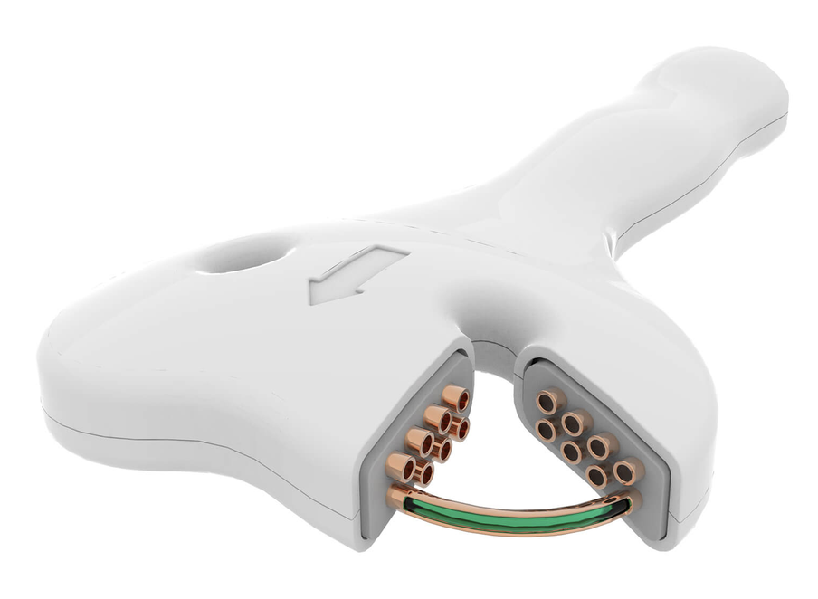
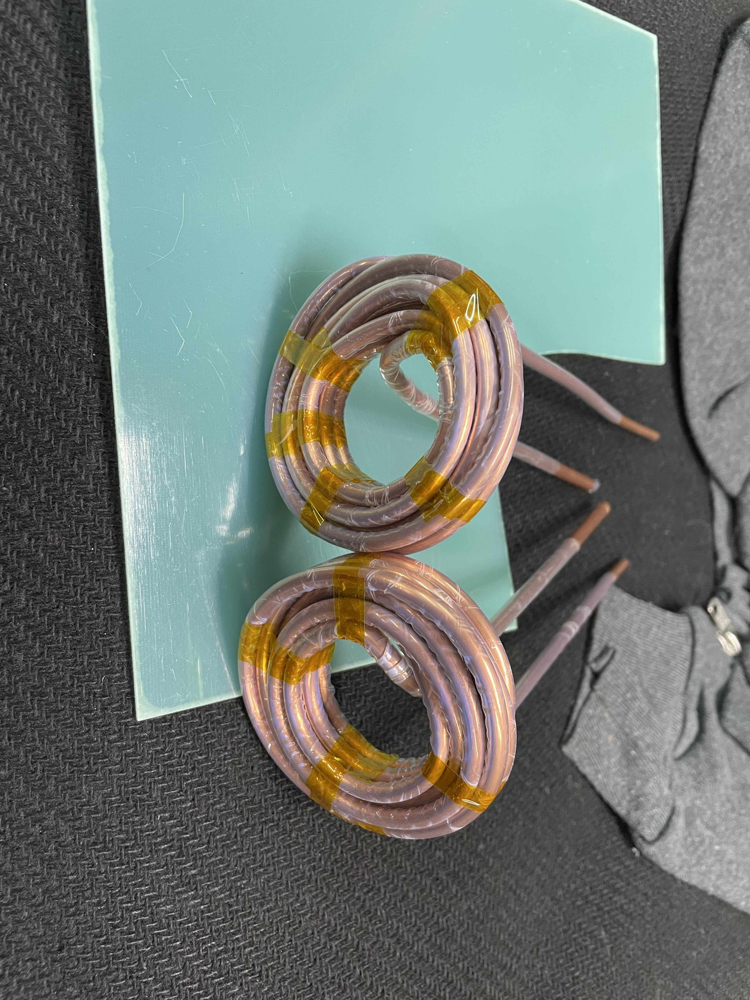
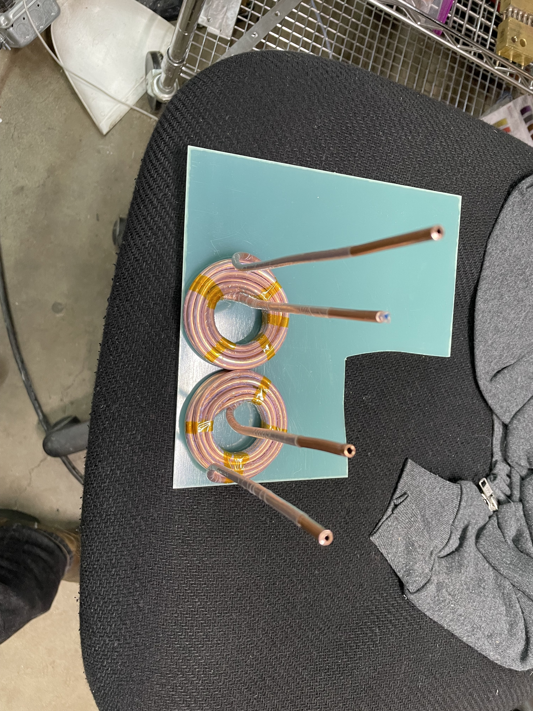
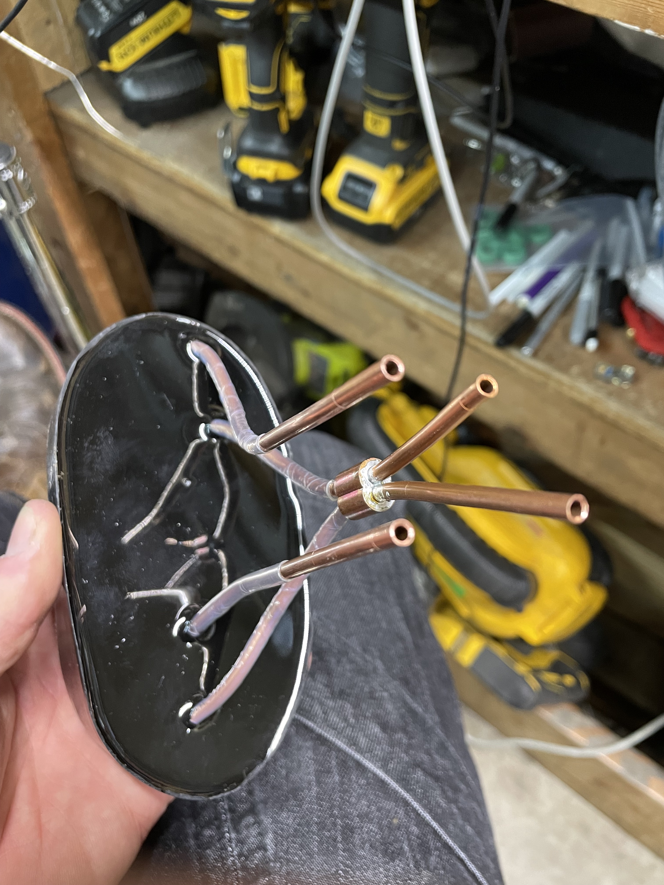
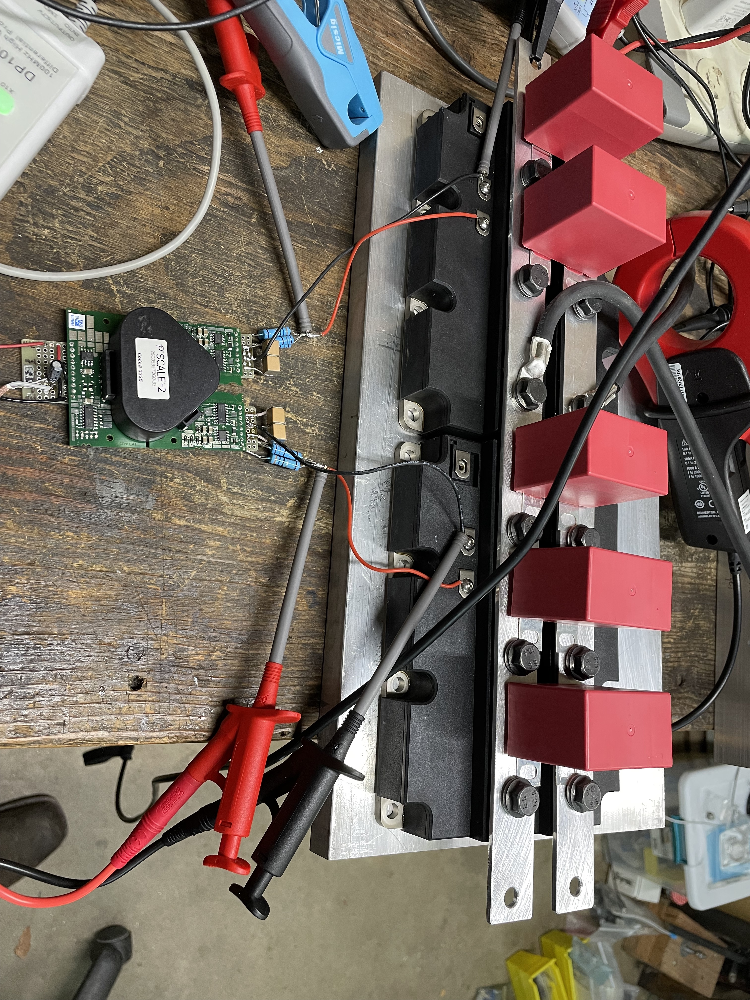
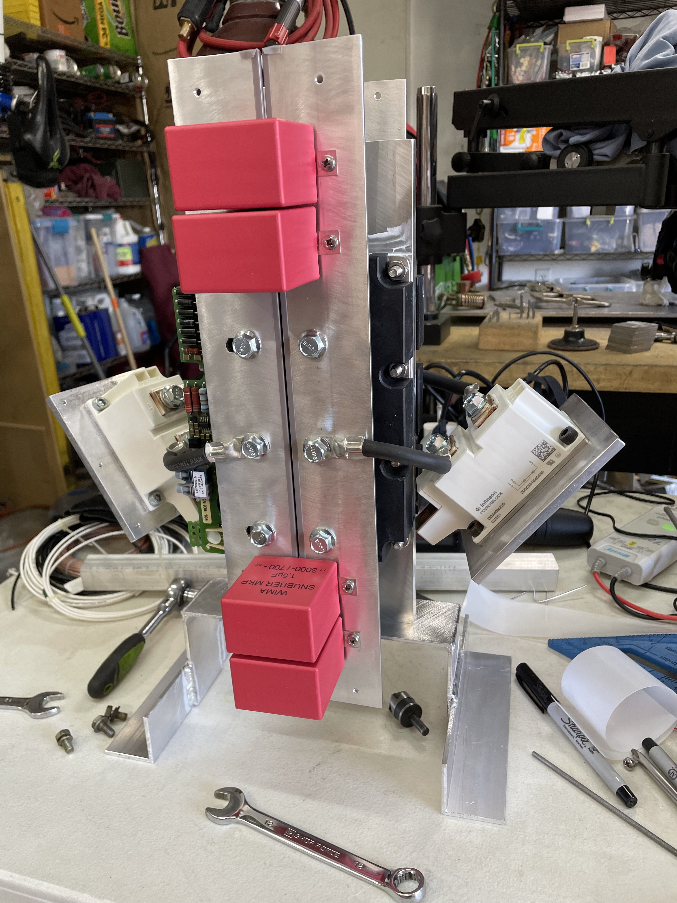
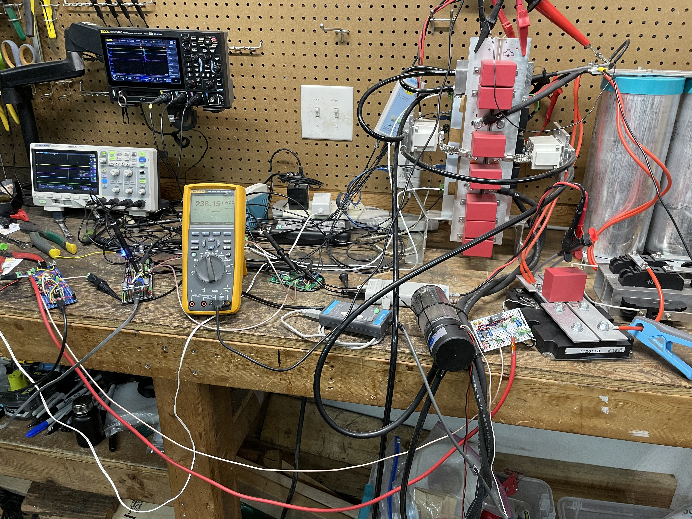
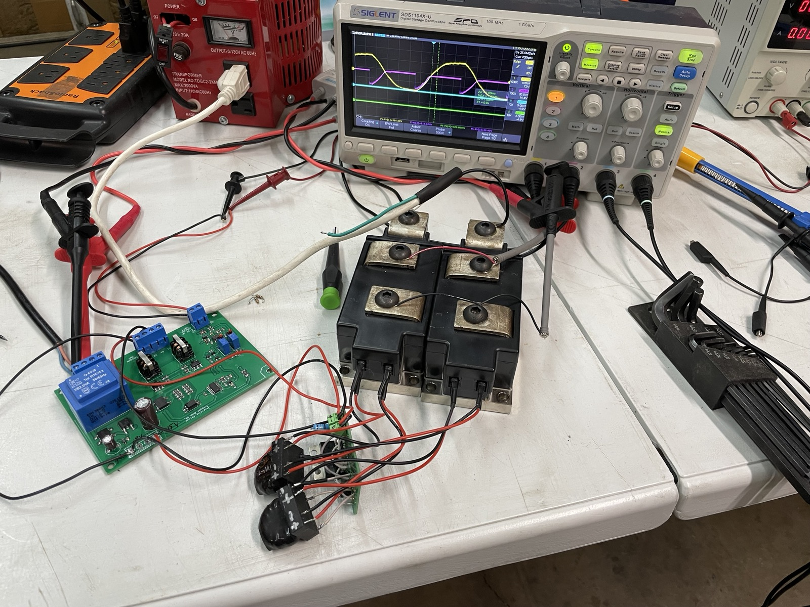
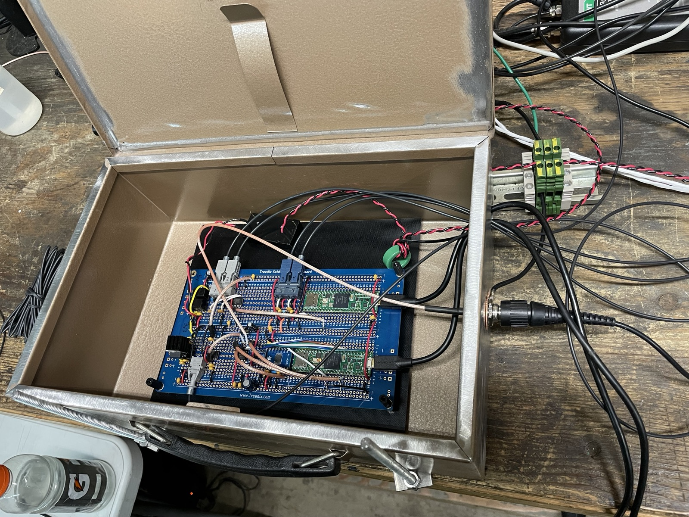

# Open-Source Transcranial Magnetic Stimulator

An open-source transcranial magnetic stimulator (TMS) project, including coil designs, pulse-generator hardware, and control/charging circuitry.

> **Safety Notice**
> This is **not** a legitimate medical device and is not a substitute for real TMS treatment. This is an experiment I built in my garage, and I cannot verify that it does what it's supposed to (if anyone wants to build an open-source MRI.... let me know...) This device is dangerous, it operates at energy levels more than enough to stop your heart, kill you, blow up and do lots of damage. If you're going to play with high energy pulsed power systems; be careful.

## Table of Contents
- [TMS Coils](#tms-coils)
- [Coil Cooling](#coil-cooling)
- [Coil Materials](#coil-materials)
- [IGBT Switches](#igbt-switches)
- [Gate Drivers](#gate-drivers)
- [Measurement System](#measurement-system)
- [Charging Circuit](#charging-circuit)
- [Pulse-Generator Designs](#pulse-generator-designs)
- [Charge-Control Circuit](#charge-control-circuit)
- [Useful Resources](#useful-resources)
- [TODO](#todo)

---

## TMS Coils

I primarily build two coil geometries — single coils and figure-8 coils. What I've focused on are air-core windings in either single-layer or multi-layer form. The general architecture is adapted from research papers and the limited information published by commercial TMS coil manufacturers. The figure-8 CloudTMS coil (below) was a major influence on my designs in terms of hollow copper conductor carrying coolant.

As I moved to higher pulse rates and energies, active cooling became necessary. My preferred approach, similar to the CloudTMS design, uses hollow copper tubing (sold for HVAC/refrigeration) insulated with PTFE heat-shrink. PTFE works well because it's a good dielectric, stays thin-walled after shrinking, tolerates high temperatures, and holds the coil shape better than thicker heat-shrink alternatives — though it does require fairly high heat to shrink fully.

**Build process:**
- Source 4mm OD / 3mm ID copper tube (5m sections) and 4.5mm, 4:1 PTFE heat-shrink in bulk.
- Feeding heat-shrink onto a long tube run takes patience — compressed air, used to create an air cushion between tube and shrink-wrap, makes this much easier.
- Wind the coil on a custom jig, either single-layer or multi-layer (multi-layer here just means winding randomly around a bobbin rather than stacking discrete single-layer coils).
- Insert something into the copper tube close to the tube's ID (weed-wacker cable works well) during the first few windings to prevent the tube from collapsing, then remove it once winding is complete.
- Hold the coil together with tape ahead of potting.

  
  

<em>Example coil before potting</em>

Potting the coil in epoxy significantly improves mechanical stability and reduces noise by keeping the windings from moving against each other under pulse forces. Hot glue works as an alternative but produces coils that are noticeably louder in operation — not confidence-inspiring at higher power levels.

<em>Example coil after potting</em>

## Coil Cooling

Coils built from hollow copper tube are cooled by pumping coolant through the winding itself.

- **Mineral oil:** Used for a long time — thinner than typical oils but thicker than water. Maintaining ~40°C required roughly 150–200 psi to push enough flow through the coil's small ID. At higher energy levels, I added a water chiller and heat exchanger to pre-cool the oil.
- **Distilled water:** More recently, I've switched to distilled water paired with a diaphragm pump, since the diaphragm provides a degree of electrical isolation between the pump mechanism and the fluid. This is simpler and more effective overall, though there is still a risk of the coolant loop reaching high voltage.

## Coil Materials

| Material | Purpose | Notes |
|---|---|---|
| [Hollow copper tube](https://www.amazon.com/dp/B082FDVNC5) | Water-cooled coil winding | Standard refrigeration-grade tube; cheap and widely available |
| [Fiberglass resin sheet](https://www.amazon.com/dp/B0DYT28W8W) | Application-side coil face | Sturdy, good electrical insulator, and appears permeable to magnetic fields — a disassembled commercial coil used what looked like FR4 fiberglass (PCB-grade) |
| [MAX EPC epoxy potting compound](https://www.amazon.com/dp/B07PMTMKZQ) | Coil potting | Inexpensive, good electrical insulator, decent thermal conductivity. For tube-cooled coils, MAX MCR (lower thermal conductivity) is also an option |

---

## IGBT Switches

My current switch of choice is the **Infineon/Eupec FZ1200R33KF2** — inexpensive and capable of handling substantial power. Prices on eBay range from ~$100–$400, and I've pushed 8kA pulses through a single unit. Adequate snubber capacitance/circuitry is essential to keep the voltage across the device under its 3.3kV rating (I target a safety margin below that).

## Gate Drivers

I've used two Power Integrations gate drivers with this IGBT listed below: but due to limitations and cost, I'm working on designing a custom gate-driver PCB which is still in progress.

- **2SC0535T2G0-33** — Functional, but lacks features like active clamping to protect against turn-off voltage spikes. Requires a custom PCB with gate turn-on/turn-off resistors and capacitors.
- **1SD418F2-FZ1200R33KF2** — Purpose-built for the FZ1200R33KF2; bolts directly onto the device pads. Requires only a 15VDC supply (I use a 1A source). It communicates over two fiber-optic channels (input signal and output/status), which I drive with custom PCBs using AFBR-1624Z HFBR transmitter/receiver modules, controlled by a Teensy 4.1 through a 3.3V→5V level shifter. NOTE: Put fiber-optic receivers (receiving fiber feedback from gate-driver) as close to Teensy/MCU as possible to reduce noise and false fault detection.
- **Custom Gate-Driver (Coming Soon)** — I've noticed that the 1SD418F2 gate drivers I'm using will sometimes detect short-circuits during operation at higher power. This could be legitamite but I'm not exceeding any voltage or current limits as measured by probes. I'm designing a custom gate-driver board since buying gate-drivers new for this IGBT with active-clamping and feedback are over $400, I want to see if I can build them for at most half of that. This will most likely involve having to wind custom isolation-transformers, since I've only found one company who makes isolation transformers rated for ~4-6kV constantly. I've ordered some parts and a 10kV HiPot tester..... more to come later.

---

## Measurement System

### Differential Voltage Measurement
Monitoring Vce (collector-emitter voltage) across each IGBT is critical to staying within its rating — I keep a safety margin and stay below 2.5kV on 3.3kV-rated devices. Since these switches operate on the high side, measurement requires a high-voltage differential probe: I use a **Micsig DP20003** (5600V, 100MHz). A similar, lower-range HV differential probe (1300V) monitors the main capacitor bank voltage.
### Custom HV Diff probe
I'm working on designing a custom HV diff probe since Micsig's new 7kV probe (only other voltage ratings are 700, 1300, 3000) is ~$700, I think it's worth it to try designing a custom probe PCB with isolated dc-dc, voltage divider, and diff opamps. For measuring IGBT voltages, I don't think I need 100MHz bandwidth, so I'm shooting for 50MHz, and hoping to get the price down to less than $100. I'm waiting on boards to show up and will update once I test them! They will probably need to be potted or atleast conformally coated to work in a variety of environments/humidity.

### Current Measurement
A shunt resistor was my first attempt but never produced a trustworthy signal. Two methods have worked well since:

1. **Rogowski coil** — Excellent for high current measurement (AC or DC, no iron core to saturate), but calibrated probes are hard to find secondhand, and a calibrated integrator circuit is needed to get a usable scope signal. I use a calibrated coil from [PowertekUK](https://powertekuk.com) — specifically the [CWTMini](https://powertekuk.com/cwtmini).
2. **Current transformer (CT)** — I use a Tektronix A621 AC current probe (rated to 2kA, available on eBay for $100–$500). In practice, it agrees with the Powertek Rogowski coil up to roughly 8kA despite the rated limit.

---

## Charging Circuit

The charging circuit is a simple, open-loop design: mains power feeds a variable transformer (variac), which drives a microwave oven transformer (MOT) to step up voltage. The stepped-up AC is rectified by a full-bridge rectifier and used to charge the main discharge capacitor bank, which is then discharged through the coil via a high-side switch (latching SCR or non-latching IGBT).

### Microwave Oven Transformers
The current two-switch flyback pulse generator uses two matched MOTs (matched by checking voltage and phase agreement between units — *measurements/resources TODO*). Drawing ~15A at 120V, two matched transformers stay below ~60°C with air cooling alone.

Earlier designs used a single MOT with low-pressure mineral-oil cooling, which worked up to ~14A — but oil cooling systems and pumps added complexity and were prone to leaks.

---

## Pulse-Generator Designs

### Design #1 — SCR-Based Pulse Generator

<em>SCR-switch pulse generator (SCRs are bottom-right. Main capacitor front left. Rectifier behind capacitor. and mineral-oil cooled microwave transformer behid rectifier. </em>

The first design I built. It handles very high energy levels well at consistent frequencies/patterns (e.g., the standard 5Hz/10Hz protocols used in early depression-treatment research). Its limitation is pattern flexibility: an SCR/thyristor is a latching switchable diode, so once triggered it fully discharges the capacitor. This steady current decay is gentle on flyback effects but rules out more complex patterns like Theta-Burst (50Hz bursts repeating at 4–5Hz).

### Design #2 — Single-IGBT Pulse Generator

<em>Single IGBT topology (note; two IGBTs in parallel), you can also see gate driver I used before using ones built specifically for the IGBT module</em>

Since IGBTs aren't latching, they can be switched on and back off within a short pulse, allowing partial capacitor discharge and enabling patterns like Theta-Burst. The tradeoff is significant flyback voltage when interrupting current through the coil — this destroyed several IGBTs before I addressed it with a robust flyback diode across the coil and snubber capacitors across the IGBT(s) to absorb spikes from parasitic wiring/busbar inductance. HV differential probes are essential here to stay within the switch's voltage rating while tuning.

This design uses a flyback diode across the coil, producing a sharp current rise but a slow fall (as flyback energy dissipates through coil/wire resistance and the diode). It worked well and was relatively simple compared to the two-switch flyback design, but since flyback energy isn't recycled, it's ultimately limited by the 120V/15A charging circuit.

### Design #3 — Two-Switch Flyback IGBT Pulse Generator

<em>Two-Switch flyback topology being built. You can see the diodes hanging off to the sides. And gate drives are now on the left, bolted to IGBT modules behind bus-bars.</em>

This design recycles more pulse energy than the single-IGBT version and produces both a sharp rising *and* falling current edge, increasing di/dt for a stronger but shorter magnetic field pulse. It noticeably reduced charging-circuit current draw and appears more effective at stimulating muscle/nerve tissue than the single-switch design, even at higher peak current — likely because faster field transitions induce greater current in tissue.
+ For this design it's important to thermally bond both IGBT/switch modules so that they're the same temperature and have the same switching characteristics. For this I bolt them each to opposite sides of an aluminum plate which I attach water-cooling blocks to.
I've been realizing the importance of keeping switching loops tight, and have shortened cabling from capacitor to IGBTs, and shortening cables from IGBTs to diodes.

<em>Photo of the system, from left-to-right; charge-control board, multimeter, main pulse-IGBTs (with many red snubber caps), charge-control IGBT (with single red snubber in front), charge-circuit-rectifier, and main pulse capacitor bank in back </em>

### Design #4 — H-Bridge IGBT Pulse Generator (Not Yet Built)
Should double coil pulse current relative to the two-switch flyback topology by enabling current reversal. The complexity of positioning four large IGBT switches and the associated snubbers and diodes close to eachother, with cooling is going to be difficult without adding parasitic inductance that would offset the gains.

---
## Phase-Controlled Rectifier

<em>Jankily built phase-control rectum-fryer, with o-smelliscope for proof</em>

I've built a phase control rectum-fryer, it works! Gotta increase the chooch-factor of the gate drivers primary drive-transistors a bit because the giant SCRs I'm using are thirsty (I think this is causing the ripple in the output waveform). Still TODO here is add another DAC for the teensy to control the phase-angle the controlled rectumfryer fires at (how much of the wave it turns to DC), and add all the PID loops and stuff here. Also, just ignore the fact that the output waveform is upside-downwards in the photo. I'll flip it I promise.

Update; I'm seeing weird behavior when adding a microwave trasformer to step up voltage, the AC waveform gets heavily distorted when I begin triggering the SCRs, and they don't seem to be fully triggering..... It works fine at the same voltage coming straight from the variable transformer, but doesn't work going through the microwave step-up transformer.

## Charge-Control Circuit

<em>Re-Packaged Charge-Control and Pulse-Firing Controllers, and put them in a shielded box since having a small EMP right next to it APARENTLY causes EMI issues.</em>

Charge controller and Pulse firing control circuits are working much better now that they're in a shielded box. No more noise causing false gate-driver faults. Which allowed me to actually see that I am sometimes getting a real fault from the gate-drivers causing them to shut off for a few seconds. I think this is not actually an over-current condition and will try to prove it. But I'm working on designing (with help from claude) a new gate-driver board for these which will report errors and let the main controller decide what to do about it.
Charge-Controller is no longer using an external ADS1115 ADC, but rather using both internal ADCs on the teensy which are noisier but much faster. Utilizing voltage dividers to bring signals down from 5v to 3.3v to keep the magic smoke in.

<em>Screenshot of a python script which displays a realtime graph and telemetry from the serial output of the teensy charge-control. Also added the ability to adjust the charge-setpoint in the python window. You can see the pulse trains as the capacitor discharges. I've added a calibration-tab here for calibrating the ADCs. I think this will change once I integrate the phase-control rectifier.</em>

Above is a screenshot of a python script which listens to voltage values sent over serial from the teensy charge controller and will display a live graph of the capacitor voltage, which is really useful for debugging as it's basically an autoscaling slow oscilliscope. The graph only shows the fast ADC's (ADS8699) calibrated capacitor voltage. It also displays other, slow-speed telemetry as numbers such as the slow ADC's calibrated capacitor voltage, slow ADC's measurement of DAC's output in both raw voltage, and the scaled/calibrated set-voltage it corresponds to (ie. I set the DAC to output a voltage which corresponds to 200V from the Micsig, I can verify that the ADC's measurement reads close enough, like 199.2V) I also added control to adjust the voltage setpoint from this python window which is useful for testing system starting from low voltage to be safe. I think there may be something with the comparator which is causing the cutoff to be slightly below the setpoint; in the screenshot you can see it cutting at ~95V instead of 100V. More calibrations....

---
## Coil Field Simulation
While I've built coils similar to what other systems use, I have difficulty understanding how fields from multiple coils interract/interfere to create focused peaks. I've asked Claude to build some tools to help visualise magnetic field strength in a 3-d map of various types of coils here [Coil_Field_Simulator_Scripts](Coil_Field_Simulator_Scripts/).
 The simulations show for instance what happens to the field when you reverse current of one of the two figure-8 windings, or have the two coils overlap. I'm hoping that I can gather data with the Coil-Field Measurement System mentioned below, to confirm what these simulations show.
I know that TMS companies construct special coils for studies called "sham-coils" which are meant to make the same sound, but the windings are wired such that the two halves of the figure-8 cancel out. These coils are used for TMS efficacy studies to give someone placebo treatment. 

## Coil Field Mapping System
I've begun the coil-measurement system! at the moment I only have the data-acquisition side built and working which is in [Coil-Field_Measurement_DAQ](Coil-Field_Measurement_DAQ/), and will have to integrate this with a 3-axis machine to move a probe around the coil to take measurements. 
As much as I wanted to use a high-speed ADC and teensy to measure pulses, it would have been alot of work to read and buffer 1M samples/s.... So I decided to use a faster USB oscilliscope instead; [DreamSourceLab DSCope](https://www.dreamsourcelab.com/product/dscope-series/) and had Claude write some python scripts which access it via the sigrok library, and visualize the results of the measurements it takes. Note; the scope I have which this code is built to interface with is a DSCope B20. 
- CH0 of the scope is measuring custom magnetic probe (a small coil of magnet-wire connected to RG316 shielded cable) 
- CH1 of the scope measures a rogowski current probe measuring the current through the coil, this is so the magentic fieldn strength can be scaled by the measured current to account for any difference in pulse strength.

## Safety Resources
- [TMS Safety with respect to seizures](https://pmc.ncbi.nlm.nih.gov/articles/PMC7732158/pdf/ndt-16-2989.pdf)
- [General article discussion factors which can decrease seizure-threshold (make it more likely you'll have a seizure)](https://www.wmchealth.org/living-well/7-everyday-factors-that-can-increase-seizure-risk)
- [Concise overview from clinic of seizure risk factors](https://www.midcitytms.com/transcranial-magnetic-stimulation-safety-with-respect-to-seizure-ndt/)

## Useful Resources

- [Online calculator used for Beam-Protocol/10-20 system to calculate position of DLPFC](https://clinicalresearcher.org/F3/calculate.php)
- [Same online calculator, where you enter your measurements](https://clinicalresearcher.org/F3/)
- [Clinical Researcher Software Tools (where I got the two links above) Contains other tools that could be useful for motor-threshold stuff](https://clinicalresearcher.org/software.htm)

## Useful Videos
- [Coil placement and the 10-20 system/beam protocol (video)](https://youtu.be/CKCvAkgdJuY?si=6TRw3_EgRK5eAh5G)
- [Same video as above with added instructions to enter measurements into clinicalresearcher calculator (link above)](https://youtu.be/akp4V5PFb6A?si=kvKB5cpgHWPCvdm8)
- [Good introductory explanation of general TMS](https://www.youtube.com/watch?v=NQHVfF_5rtc)
- [Funny video of the TMS researcher interrupting his speach with TMS](https://www.youtube.com/watch?v=85QKdt8boMA)
- [Researcher showing TMS stimulating muscles directly and muscles through the motor-cortex](https://www.youtube.com/watch?v=JA0q4fVqrFQ)
- [Good Long-Form explanation of someone who runs a TMS clinic showing how they get a patient setup, and perform treatment](https://www.youtube.com/watch?v=WxCunEG2oi0)

## TODO
1. **UPDATE THE SCHEMATICS**
2. **Refine charge-control switch** The charge controller is working well now. But I'm using a rediculously big IGBT to switch just a few tens of amps. Need to find a smaller IGBT/switch which can withstand ~2-3kV to be on the safe-side.
3. **Finish Integrating phase-control rectifier** I've built a phase control rectum-fryer, it works. Gotta increase the chooch-factor of the gate drivers primary drive-transistors a bit because the giant SCRs I'm using are thirsty. Still TODO here is add another DAC for the teensy to control the phase-angle the controlled rectumfryer fires at (how much of the wave it turns to DC), and add all the PID loops and stuff here. 
4. **Process gate-driver fault feedback** Reading status/feedback from gate-drivers is working now and has latching/blinking LEDs/indicators to indicate warnings and faults. There is functionality to turn off a safety relay, disconnecting power from a subsystem or whole system which I'll get wired up later.
5. **Extend functionality to Pulse-Driver Teensy** I'd like to add the ability to run different patterns/protocols, maybe add input (with damn good shielding) so user can press a button to fire a single pulse. And add the ability to choose different pulse-patters, like various continuous or intermittent rTMS(repetitive) frequencies. Also various TBS-based protocols (Thea-Burst Stim); continuous (cTBS) and intermittent (iTBS) with adjustments for various parameters such as train-frequency, inter-train delay and such.
6. **Finally build a tool to map the magnetic field strength & shape of a coil.** My idea is basically put a precise analog hall-effect sensor on some 3d gantry machine like a 3d printer, and have it scan over many 3d points around the coil and create a 3d heat-map of magnetic field strength. Anyone know how to use 3d-printers? and know how to make them scan some end-effector to create a map like this???? I'd love some help!
7. **Better Shielding / Shielded Enclosure** This is basically a small EMP... so I find myself having to filter out interference on EVERYTHING at exactly the time the IGBT turns off (the turn-off spike). What if I just put everything in a shielded/grounded metal box??? Surely it wouldn't be that easy right??
8. **Create Bill-Of-Materials for each design** Create BOMs for what parts I've used in the various designs of TMS systems. Most coil materials are the same. But it would be useful to have BOMs for the SCR-based and IGBT-based pulse-generator designs.
9. **Maybe implement Micsig's command and control protocol over USB/serial** Micsig's command and control interface can configure the voltage range and bandwidth of the probe, and can read the probes serial number. Reading the serial number would allow the control software to load a specific calibration for a specific serial number of probe to ensure accuracy. Could also have a fallback/safe mode the system could operate in when connected to uncalibrated probes.